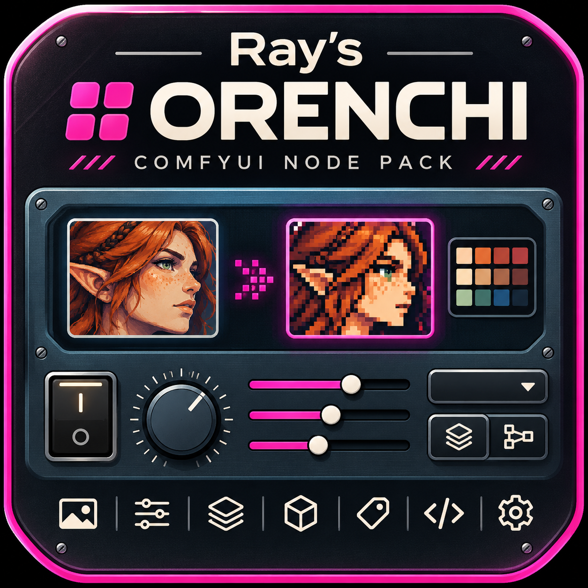

# comfyUI-Ray-Orenchi

29 ComfyUI custom nodes for retro image effects, pixel art, local vision-language
inference, prompt tooling and analog-console controls. Find them under the
**👑 Ray** category in the add-node menu.

<br clear="left">

## Nodes

| Group | Node | What it does |
|:--|:--|:--|
| **✨ VFX** | **CRT** | Display simulation: phosphor masks, scanlines, halation, NTSC bleed, barrel distortion |
| | **Offset Print** | CMYK or duotone halftone printing with paper simulation |
| | **Pixel Art** | Repair or convert images to true pixel art: palettes, selective dithering, outlines |
| | **Film Stock** | Film response, grain and halation, with optional LUT/XMP assets |
| | **VHS / Tape** | Analog tape degradation, tracking faults, dropouts and a VCR on-screen display |
| **🎛️ Analog** | **Control** | Retro knobs and sliders with sound and optional pot-taper response curves; outputs a float and an int |
| | **Switch** | Retro toggles and rockers with sound; outputs a boolean |
| | **Button Deck** | A bank of push buttons that replaces a dropdown; outputs the pressed button's text |
| | **Fader Bank** | Two to ten vertical faders in a row, up to four rows, each a 0 to 1 float, plus the whole bank as a list |
| **💬 LLM** | **Fast Qwen3-VL Infer** | Generate image or text responses with an already loaded generative Qwen CLIP |
| | **Folder Captioner** | Caption images in a folder; aligned caption/path lists and optional returned images |
| **🔧 Tools** | **Folders** | Browse and select local images, videos and audio; native media lists, prompts and paths |
| | **Save Image** | Save PNGs or preview them, with a two-image comparison slider and folder picker |
| | **Model Card** | Generate a visual model benchmark, full card, reduced preview, source batch and Markdown report |
| | **TXT Folder** | Read text files as prompts, with matching save prefixes |
| | **Metadata Inspector** | Read generation metadata from an image, or embed it into one |
| | **Prompt Scraper** | One node for prompts from a local image folder, PromptDexter or CivitAI |
| **🧰 Model Tools** | **Load Model As / Convert Model / Save Model** | Load, convert and save effective model weights, with native FP8/INT8/ConvRot support |
| | **Queued Model Loader** | Pass a native MODEL list through one execution, with automatic precision and optional Spectrum |
| | **Metadata Load / Edit / Metadata Save** | Editable model metadata table, structured JSON sidecars, and lossless tensor-block copies |
| | **Model Merge** | Nine seeded merge strategies, component selection and block weights |
| | **Model Inspector / Model Compare** | Tensor tables, architecture detection and structural comparison |
| | **LoRA Bake / LoRA Extract** | Bake supported adapters or extract low-rank checkpoint differences |
| | **LoRA QKV Loader** | Stack model LoRAs with individual strengths and automatic naming/QKV compatibility fixes |

See [MODEL_TOOLS.md](MODEL_TOOLS.md) for formats, examples and file-only workflows.

Nodes are named *Ray's &lt;Group&gt;: &lt;Node&gt;* in the menu. Select any Ray node and click the
**?** in its selection toolbar for built-in help: what it does, every input and output,
and usage notes.

## Install

```shell
cd ComfyUI/custom_nodes
git clone https://github.com/MutantSparrow/comfyUI-Ray-Orenchi.git
pip install -r comfyUI-Ray-Orenchi/requirements.txt
```

Install into the Python environment that runs ComfyUI, then restart ComfyUI and refresh
the browser. After updating the pack, restart again so new and changed nodes load.

The supported test matrix is Python **3.11–3.13**, ComfyUI **0.42.0+**, with
CI targeting stable **0.42.4** and current `master`. Torch/CUDA and the model runtime
are owned by ComfyUI; the pack does not install or upgrade Torch.

## Good to know

- **Fast Qwen3-VL Infer** uses a full native Qwen3 checkpoint or encoder that still retains its LMHead which are more modern DIT model's encoders
, loaded with  ComfyUI's `CLIPLoader` (type `qwen_image`, or `krea2`). Connect its `CLIP`, an image and
  a prompt. Compatible generative text-only Qwen models use their native generator.
  Details and measurements are in [FAST_VLM.md](FAST_VLM.md).
- **Network access:** Folders browsing is local-only by default. To permit remote
  read access, set `RAY_FOLDERS_REMOTE_ROOTS` to approved absolute directories
  before starting ComfyUI, separated by `;` on Windows or `:` on Linux/macOS.
  Subfolders are included, and every read request checks the allowlist. Asset
  deletion, Browse dialogs and Open location remain local-only. Reverse proxies
  and tunnels must preserve client information and enforce their access controls;
  an unmarked loopback tunnel cannot be distinguished from a local client. This
  policy covers these HTTP routes, not workflows or other extensions.
- **Folder Captioner** needs a GPU and the same kind of full Qwen3-VL `CLIP` from `CLIPLoader` as Fast Qwen3-VL.
- **Browse buttons** under folder and file paths open your system's own file dialog, so ComfyUI has to run on the computer you are using. Typing or pasting a path always works.
- **Prompt Scraper**'s PromptDexter and CivitAI modes need network
  access. CivitAI can read an optional local `civitai.secret` file.
- Works in both the classic canvas and Nodes 2.0. Node IDs are stable, so saved workflows
  keep loading.


## Documentation

[NODES.md](NODES.md) is the node-by-node reference for inputs, outputs and behavior.

[FOLDERS.md](FOLDERS.md) covers the media gallery, selection, filtering and outputs.

[MODEL_TOOLS.md](MODEL_TOOLS.md) covers loading, conversion, merging, metadata,
LoRAs and saving, with workflow examples. Default node screenshots are included
throughout the node guide.

## License

Apache License 2.0, see [LICENSE](LICENSE). The vendored Pixel Art Fixer grid detector is
MIT-licensed; see its [license](ray_pixel_fixer/LICENSE) and [notice](ray_pixel_fixer/NOTICE.md).
